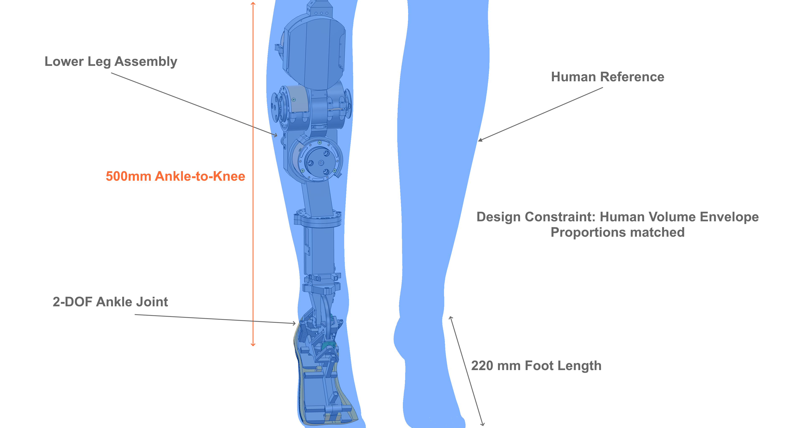
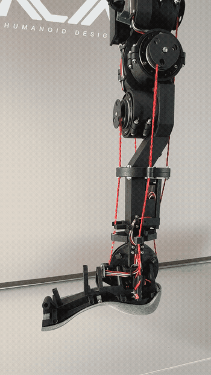
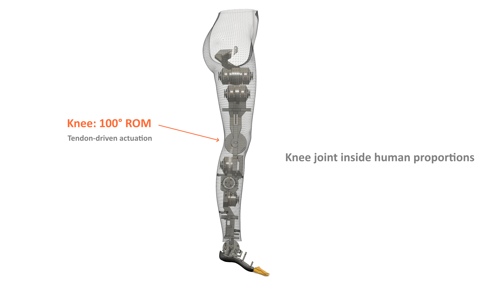
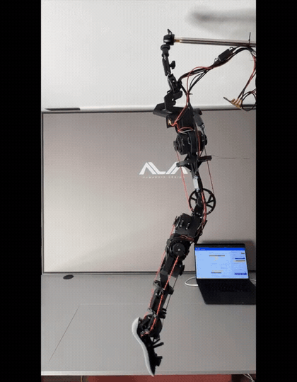
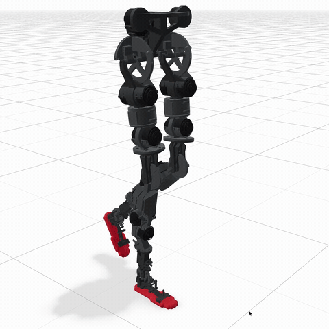
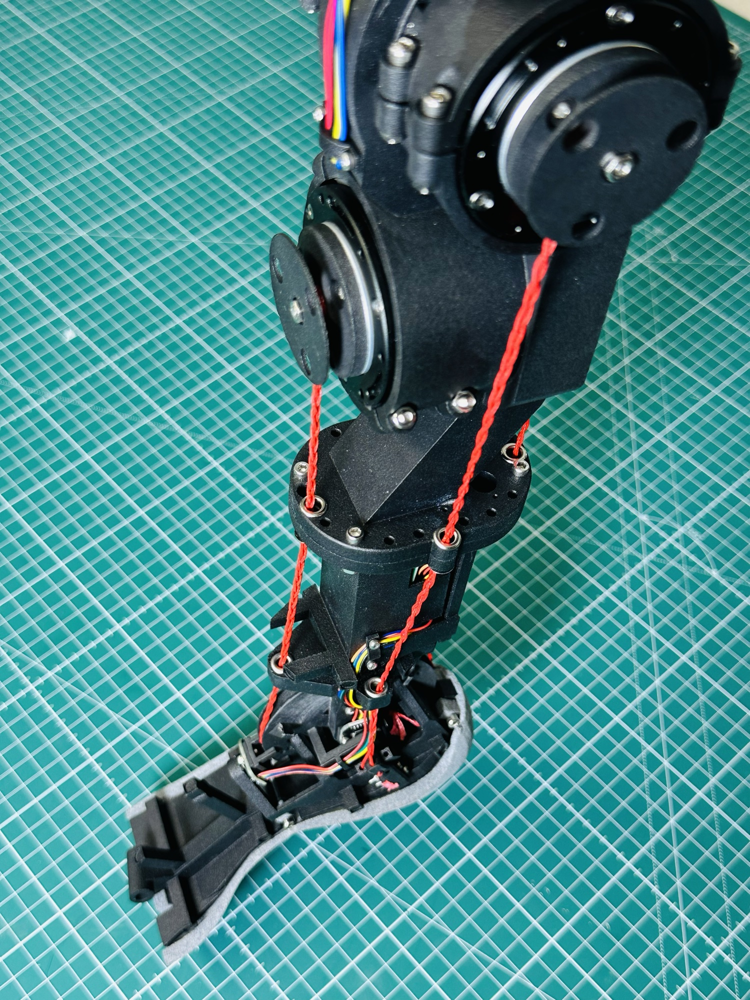
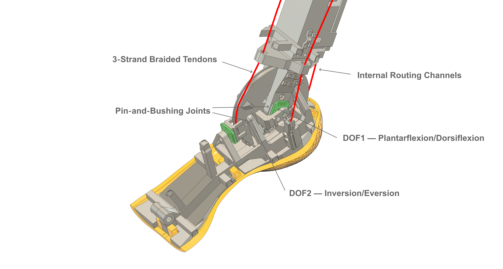

<p align="center">
  <picture>
    <source media="(prefers-color-scheme: dark)" srcset="docs/media/alia-banner-dark.png">
    
  </picture>
</p>

# Alia Humanoid

**Building humanoid mechanics inside real human proportions.**

[](https://github.com/aliahumanoid/alia-humanoid-core/actions/workflows/firmware-ci.yml)

<table>
<tr>
<td width="70%">

</td>
<td width="30%">
<a href="https://youtu.be/1Z9GlTnYEFs">
  
</a>
</td>
</tr>
<tr>
<td align="center"><i>Lower leg and ankle (CAD): human-scale comparison</i></td>
<td align="center"><i>Right ankle prototype — 2-DOF motion test</i></td>
</tr>
</table>

<table>
<tr>
<td width="65%">
  <a href="https://youtu.be/4jU5Na2z-s8">
    
  </a>
</td>
<td width="35%">
  <a href="https://youtu.be/4jU5Na2z-s8">
    
  </a>
</td>
</tr>
<tr>
<td align="center"><i>Knee joint overlay — Joint Design Log #002</i></td>
<td align="center"><i>Right knee prototype — 1-DOF motion test</i></td>
</tr>
</table>

<table>
<tr>
<td align="center">
<a href="https://x.com/AliaHumanoid/status/2062545958991265831">
  
</a>
</td>
</tr>
<tr>
<td align="center"><i>Walking gait in physics simulation (June 2026): a policy for the 12-DOF legs, trained by motion tracking on one reference gait. Simulation, not hardware.</i></td>
</tr>
</table>

---

## What We're Building

A humanoid robot designed from the ground up to fit within real human dimensions and proportions. 

We design inside real human dimensions instead of a larger envelope. That constraint forces design decisions (motor placement, transmission routing, thermal budget) that a larger robot could avoid. The goal is a robot that fits human environments and works at human scale, using tendon-driven actuation, custom motor placement and tight mechanical integration.

**Current Phase 0 Focus:** Lower body (hip + knee + ankle) — tendon-driven and direct-drive actuation.

### What This Repository Contains

The software follows an open-core boundary: this repository carries the **replication core** — firmware, protocols, base host operation, hardware documentation, and results. Advanced lab tooling (calibration campaigns, learning-control experiments, gait tooling) is developed in a private suite and opens progressively as milestones mature. Results, Joint Design Logs and technical notes continue to be published. We publish what fails alongside what works; simulation results are labeled as simulation results.

### Latest Updates
- 2026-11-09: **Joint Design Log #003 (Hip)**: the three-axis hip on the bench, hanging free. One cycle of our simulated walk replayed at half speed on all three axes (about 0.25° rms on flexion, 0.1° on the roll), then a synthetic gait-like cycle at full speed on the two tendon axes with the roll held still (about 0.6° rms on flexion, 0.15° on abduction); the joint was stopped twice that day without our asking. [YouTube](https://youtu.be/a9sh70xy4z0) · [X post](https://x.com/AliaHumanoid/status/2119707647737819585) · [details](PUBLIC_UPDATES.md)
- 2026-09: **Hip roll motor integrated**: the two tendon-driven DOFs and the direct-drive roll run together on one joint controller; first runs, no numbers published. Results from later runs: Joint Design Log #003 (2026-11-09)
- 2026-08-27: **Hip on the bench: first runs at full speed.** The 2-DOF tendon-driven hip tracks a gait-like reference (flexion and abduction sines in quadrature, 1.1 s cycle), free swing with no external load, with one learned feed-forward correction from a previous run (uncorrected at the same speed: 6.0° / 2.0° rms): 27 cycles, 2.95° / 1.37° rms, repeatable run to run — [X post](https://x.com/AliaHumanoid/status/2092992852150108425) (the post calls it the simulation policy's walking trajectory; the reference was a synthetic gait-like cycle)
- 2026-08: Direct-drive hip roll validated on a separate single-motor bench, free shaft (reference persistence, sweeps; a segment of the simulated walking trajectory tracked on hardware at about 0.3° rms with the motor's internal position loop, after timing and learned corrections)
- 2026-07: **Development drop** — control-loop rate hardening (bench-validated to 625 Hz on the ankle), joint-map capture improvements, saved-offset warm-boot fast path, MOTION GUARD V2 (gait-aware safety guards; ships disabled, bench validation pending), host impedance-stream `tau_ff` channel (on tendon joints it changes tendon tension, not joint torque; see the [SET_IMPEDANCE guide](software/docs/SET_IMPEDANCE_OPERATIONAL_GUIDE.md)) — [details](PUBLIC_UPDATES.md)
- 2026-07-18: **Technical note published:** [Deterministic boot-time offset reconstruction for tendon-driven joints](https://aliahumanoid.com/notes/deterministic-boot-offset-reconstruction.html) — method published as prior art
- 2026-07: **License change:** software is GPLv3 from this release (prior MIT snapshots remain MIT); protocol specs stay MIT; hardware licensing unchanged — [rationale](PUBLIC_UPDATES.md)
- 2026-06-04: **Walking gait in simulation**: 12-DOF legs, a policy trained by motion tracking on one reference gait, exported as one ONNX policy and checked locally. Simulation, not hardware. [X thread](https://x.com/AliaHumanoid/status/2062545958991265831) · [details](PUBLIC_UPDATES.md)
- 2026-06: Per-joint power board (`rev_d_power`) validated on the bench: power rails, hot-swap switching, health telemetry, and closed-loop control of one motor at low current (0.08° steady-state error after a 5° step); high-current limits not yet exercised ([report](hardware/electronics/joint_controller_board/rev_d_power/BENCH_VALIDATION_REPORT.md) · [known issues](hardware/electronics/joint_controller_board/rev_d_power/README.md))
- 2026-04: Hip hybrid firmware path implemented (3 DOF / 5 motors)
- 2026-01-26: Joint Design Log #002 (Knee) published — [YouTube](https://youtu.be/4jU5Na2z-s8) · [X thread](https://x.com/AliaHumanoid/status/2015812906101657848)
- 2025-11-13: Joint Design Log #001 (Ankle) published — [YouTube](https://youtu.be/1Z9GlTnYEFs)
- 2025-10-31: Phase 0 public release — [PUBLIC_UPDATES.md](PUBLIC_UPDATES.md)

### Key Features

- 🦶 **2-DOF Ankle Joint**
  Plantarflexion/dorsiflexion and inversion/eversion; design range −50° to +25° and ±25°

- 🦵 **1-DOF Knee Joint**
  Full flexion/extension (0° to 100°) with antagonistic tendon pair

- 🦴 **3-DOF Hip Joint (Hybrid)**
  Flexion/extension + abduction/adduction (tendon-driven) + axial roll (direct-drive), 5 motors

- 🧵 **Tendon-Driven Actuation**
  Antagonistic motor pairs with cascade PID, plus single direct-drive for hip roll

- 📏 **Human-Scaled Design**  
  Designed inside real human leg envelope — not scaled up

- ⚙️ **Real Hardware Iteration**  
  PA12 nylon structure (multi jet fusion), pin-and-bushing joints, UHMWPE tendons

- 🖥️ **Jetson Multi-Joint Controller**
  CAN-direct impedance streaming at 50Hz, automated exercise patterns, CAN-first diagnostics

- 🚶 **Walking: simulation only**
  A walking gait for the legs, learned in physics simulation by imitating one reference gait (June 2026); not on hardware

- 📂 **Files released in phases**
  Phased licensing roadmap: STL → STEP → CAD source

---

## What Works ✅ / What Doesn't ⚠️

We document **both successes and failures** transparently.

> **Safety:** before powering any joint, read [Known safety limitations](SAFETY_LIMITATIONS.md).

### ✅ Validated On Hardware (Phase 0)

- Knee validated as a single-controller baseline (April 2026) — [Joint Design Log #002](https://youtu.be/4jU5Na2z-s8)
- Ankle validated as a single-controller baseline (April 2026) — [Joint Design Log #001](https://youtu.be/1Z9GlTnYEFs)
- Knee and ankle coordinated from one host on the bench (`KNEE_RIGHT + ANKLE_RIGHT`); extended recovery cases still open. After an e-stop, follow [Known safety limitations](SAFETY_LIMITATIONS.md): on `rev_d` boards, power-cycle (motor supply first, then USB) and run the startup again; never recover with `PRETENSION`
- Protocol v1.0 freeze documented for the current knee+ankle bench baseline — [CAN system architecture §4.5](software/docs/CAN_SYSTEM_ARCHITECTURE.md)
- Ankle: both axes under closed-loop control on the bench. The ranges in the [ankle spec](docs/specs/ANKLE_SPECIFICATIONS.md) are design ranges; its test results list open items (±8° error when both axes move together, manual tendon pre-tension).
- Knee ROM and tendon-driven position control validated (0-100 degrees)
- PA12 ankle structure passed a static load test at 3× body weight, for the robot's 25 kg design mass ([ankle spec](docs/specs/ANKLE_SPECIFICATIONS.md))
- Rolling impedance control via CAN with cascade PID on the validated tendon-driven joints — [operational guide](software/docs/SET_IMPEDANCE_OPERATIONAL_GUIDE.md)
- Per-joint power board (`rev_d_power`) validated on the bench: power rails, hot-swap switching, health telemetry, and closed-loop control of one motor at low current (0.08° steady-state error after a 5° step); high-current limits not yet exercised — [bench report](hardware/electronics/joint_controller_board/rev_d_power/BENCH_VALIDATION_REPORT.md) · [known issues](hardware/electronics/joint_controller_board/rev_d_power/README.md) (motor rail sags on touch or gate-node contamination; handling rules)

### ⬚ Simulation Only (Not Hardware)

- June 2026: walking gait for the 12-DOF legs, a policy trained by motion tracking on one reference gait; exported as one ONNX policy and checked locally, with an observation-parity check between training and inference
- Domain randomization on actuator gains, latency and mass
- Transfer from simulation to hardware first needs a foot sole, power boards at scale and batteries

### ◐ Hip — On the Bench (August–October 2026)

> **Safety:** the published firmware has a known sign error in the hip's outer position loop. Do not run the hip tendon axes in closed loop with it; see [Known safety limitations](SAFETY_LIMITATIONS.md).

These bench runs used firmware and host tooling that are not in a public release yet; this repository carries the hybrid hip model and the `HIP_ROLL_BENCH_*` profiles.

- Hip hybrid model (`3 DOF / 5 motors`, per-DOF `DriveType` / `DofCapabilityFlags`) exercised on hardware: both tendon-driven DOFs mapped, calibrated and driven with the hybrid-aware auto-mapping path (at the end of a mapping run the joint is released and the limb can fall: support the limb at the end of the mapping and re-seat the tendons before the next startup; see [Known safety limitations](SAFETY_LIMITATIONS.md))
- Joint encoders zeroed at the CAD mechanical stops, persistent across power cycles
- Gait-like reference (flexion and abduction sines in quadrature, 1.1 s cycle) tracked on the physical hip (2 tendon-driven DOFs) at full speed, free swing with no external load, with one learned feed-forward correction from a previous run (uncorrected at the same speed: 6.0° / 2.0° rms): 27 cycles, 2.95° / 1.37° rms, repeatable run to run — [X post](https://x.com/AliaHumanoid/status/2092992852150108425) (the post calls it the simulation policy's walking trajectory; the reference was a synthetic gait-like cycle)
- Direct-drive axial roll validated on a separate single-motor bench, free shaft (`HIP_ROLL_BENCH_*` profiles): reference persistence across power cycles, sweeps, a segment of the simulated walking trajectory tracked on hardware at about 0.3° rms with the motor's internal position loop, after timing and learned corrections
- All three axes on one controller, hanging free (31 October 2026): see Joint Design Log #003 under Latest Updates, with its numbers and limits

### 🛠️ Implemented In Firmware, Pending Bench Validation

- MOTION GUARD V2 — gait-aware divergence/stall guards behind a runtime mode switch (ships in LEGACY mode = current behavior; SHADOW/ACTIVE pending bench validation)

### ⚠️ Still Iterating

- Not shown yet: the three hip axes validated together. Shown so far: all three at half speed on a replayed cycle of our simulated walk; at full speed, only the two tendon axes with the roll held still ([Joint Design Log #003](https://youtu.be/a9sh70xy4z0))
- Hip, knee and ankle on one host (multi-controller integrated test)
- Walking gait as integrated lower-body system **on hardware**
- Sim-to-real transfer (policy deployment on the onboard computer; gated by foot sole, power boards at scale, batteries)
- Power board high-current stress testing (22A continuous / ~38A peak)
- UHMWPE tendons: in use at current bench loads; the configured motor torque limits have not yet been checked against the rope's breaking load ([Known safety limitations](SAFETY_LIMITATIONS.md))


---

## Architecture

```
Jetson host (Python)          RP2350 joint controller (C++)          Motors
SET_IMPEDANCE @50Hz  --CAN-->  core0: encoders (MT6835, SPI)   --CAN--> antagonistic
per-DOF gains/tau_ff           core1: cascade PID + safety              tendon pairs
                               (bench-validated to 625 Hz)              (+ direct-drive hip roll)
```

- [CAN system architecture](software/docs/CAN_SYSTEM_ARCHITECTURE.md) — protocol, IDs, freeze policy
- [SET_IMPEDANCE operational guide](software/docs/SET_IMPEDANCE_OPERATIONAL_GUIDE.md) — the impedance streaming interface
- [Firmware update protocol spec](software/docs/CAN_FIRMWARE_UPDATE_PROTOCOL_SPEC.md) — CAN-based firmware updates

## Build & Run

**Host (runs without hardware):**
```bash
cd software/host && python3 -m venv .venv && . .venv/bin/activate
pip install -r requirements.txt && python main.py   # web UI on :5001
```

**Firmware (PlatformIO, RP2350 Pico 2), for the published rev_d logic and power boards:**
```bash
cd software/firmware/joint_controller && pio run -e pico2_debug_rev_d
```
The default environment does not define `SAFETY_BOARD_REV_D`; see [PINOUT.md](software/firmware/joint_controller/PINOUT.md).

Bench bring-up: [Jetson single-controller checklist](software/docs/JETSON_SINGLE_CONTROLLER_BRINGUP_CHECKLIST.md). Minimum bench: one joint controller board, a CAN adapter, a 24 V supply and a physical emergency stop that cuts the motor supply. Read [Known safety limitations](SAFETY_LIMITATIONS.md) before powering any joint.

## Current Status (Phase 0)

Last reviewed: 2026-11-19. Ankle and knee validated as single-controller baselines; hip on the bench; walking shown in simulation only.

| Component | Status | License | Notes |
|-----------|--------|---------|-------|
| **Software** | ✅ Public | GPLv3 | Python host + C++ firmware (RP2350 Pico 2); releases before July 2026 remain MIT |
| **Hardware Docs** | ✅ Public | CC BY-NC-ND | BOM, mechanical release guide, joint/motor/tendon specs |
| **STL Files** | ✅ Public | CC BY-NC-ND | 19 files: ankle, lower leg, common components |
| **Electronics** | ✅ Public | CC BY-NC-ND | Joint controller logic board (RP2350), per-joint power board, encoder hub and motor CAN/power hub: KiCad source and STEP; fabrication packages for the logic board and the two hubs |
| **CAD Source** | 📅 Phase 2+ (TBD) | CC BY-SA | Full parametric Fusion 360 timeline |

See our [licensing roadmap](hardware/LICENSE.md) for details on what is released when.

---

## Quick Links

- 📺 **[YouTube Channel](https://www.youtube.com/@aliahumanoid)** — Design logs, demos, technical breakdowns
- 🐦 **[X/Twitter (@AliaHumanoid)](https://x.com/AliaHumanoid)** — Project updates, iteration logs
- 🌐 **[Website](https://aliahumanoid.com)** — Project overview and roadmap
- 📝 **[Public Updates](PUBLIC_UPDATES.md)** — Public milestone log and release notes
- 📖 **[Documentation](software/README.md)** — Software architecture, protocols, build guides
- 📐 **[Technical Specs](docs/specs/README.md)** — Joint specifications, motor specs, tendon specs
- 🗒️ **[Technical Notes](https://aliahumanoid.com/notes/deterministic-boot-offset-reconstruction.html)** — Method writeups published as prior art

**Evaluating this project? Start here:** (1) watch a Joint Design Log, the newest is [#003, the hip](https://youtu.be/a9sh70xy4z0); (2) read the [boot-reconstruction technical note](https://aliahumanoid.com/notes/deterministic-boot-offset-reconstruction.html) (the method is published; its implementation is not part of this repository); (3) read the firmware control loop (`software/firmware/joint_controller/src/JointController_ControlLoop.cpp`). Issues with findings are welcome.

---

## Gallery

<table>
<tr>
<td width="50%">

<p align="center"><i>Right lower leg and ankle prototype (Phase 0)</i></p>
</td>
<td width="50%">

<p align="center"><i>Ankle cutaway showing tendon routing</i></p>
</td>
</tr>
</table>

---

## What Comes Next

**Next, in order, no dates:** the full right leg, hip, knee and ankle mounted together; then the left side. Hardware files open in validation-gated steps; see [License](#license).

---

## Follow Progress

This repository documents Phase 0 validation work in public. Small software/docs improvements and evidence-based feedback are welcome. See [CONTRIBUTING.md](CONTRIBUTING.md) for the current collaboration boundary.

**Ground Rules:**
- All commits require DCO sign-off: `git commit -s`
- Use English for code/comments/issues
- Follow conventional commit format (`feat:`, `fix:`, `docs:`, etc.)

**Current Accepted PR Scope:**
- 🐛 Bug reports and fixes
- 📖 Documentation improvements (clarity, examples)
- 🧪 Testing and validation reports (especially hardware replication)
- 💡 Feature proposals (via issues first)

**Not Yet Open As PR Surface:**
- Hardware geometry changes to STL/CAD assets
- Canonical hardware design modifications while the public hardware release remains STL-only

For hardware design ideas, replication findings, and geometry feedback, open an issue first with evidence, measurements, or photos.

---

## References & Acknowledgments

### Control Architecture

The cascade control structure implemented for antagonistic tendon-driven actuation is inspired by the approach described in:

> **Lukić B., Jovanović K., Šekara T. B. (2019).**  
> *Cascade Control of Antagonistic VSA — An Engineering Control Approach to a Bioinspired Robot Actuator.*  
> Frontiers in Neurorobotics, Vol. 13, Article 69.  
> DOI: [10.3389/fnbot.2019.00069](https://doi.org/10.3389/fnbot.2019.00069)

The original paper presents a double-loop cascade architecture for simultaneous position and stiffness control of an antagonistic Variable Stiffness Actuator (VSA). 

In Alia's implementation, this concept has been extended and generalized to a multi-DOF humanoid control system, featuring:
- Coordinated cascade loops for multiple joints
- Per-DOF tuning of PID gains (inner loop: motor position, outer loop: joint position)
- Dynamic modulation of cascade influence and stiffness reference
- Synchronized trajectory generation for agonist–antagonist motor pairs

This implementation is an independent engineering development released under the GNU GPLv3 (releases before July 2026: MIT).

---

## License

- **Software (firmware + host):** [GNU GPLv3](LICENSE) from the July 2026 release onward. Releases published before July 2026 were MIT and remain MIT — irrevocable for anyone who obtained them.
- **Protocol specifications** ([CAN system architecture](software/docs/CAN_SYSTEM_ARCHITECTURE.md), [firmware-update protocol](software/docs/CAN_FIRMWARE_UPDATE_PROTOCOL_SPEC.md)): **MIT**, so third-party tools can integrate without copyleft obligations.
- **Hardware:** unchanged — see [hardware/LICENSE.md](hardware/LICENSE.md) for the phased CC roadmap.

Contributions are accepted under the license of the files they change: GPLv3 for software, MIT for the protocol specifications; hardware contributions follow the phased roadmap in [hardware/LICENSE.md](hardware/LICENSE.md). Every commit needs a DCO sign-off; see [CONTRIBUTING.md](CONTRIBUTING.md#license-acknowledgement).

---

### How the pieces fit (what protects what)

| Layer | License / instrument | What it means in practice |
|---|---|---|
| Firmware + host software | **GPLv3** (July 2026 onward; earlier snapshots remain MIT) | Commercial use is allowed; modified versions must stay GPLv3 |
| Protocol specifications | **MIT** | Third-party tools can implement the protocols without copyleft obligations |
| Hardware (STL, docs, BOM) | **CC BY-NC-ND 4.0** today → CC BY-NC-SA (STEP) → CC BY-SA (CAD source) | Print and study now; no commercial use or derivatives yet; opens in phases, see [hardware/LICENSE.md](hardware/LICENSE.md) |
| Published technical notes | **Public prior art** | The methods stay free for everyone to use. Prior art does not restrict copying; the licenses above do |
| Name and logo | Not covered by any of the above | Trade mark rules apply separately |

ALIA HUMANOID is a registered EU trade mark (EUTM 019380142). The name and the brand are not covered by the licenses of this repository.

## Developer Certificate of Origin (DCO)

All commits must include a `Signed-off-by` line to certify you have the right to contribute:

```bash
git commit -s -m "feat: add ankle calibration script"
```

This asserts compliance with the [Developer Certificate of Origin](https://developercertificate.org/).

---

## Contact

- **General:** info@aliahumanoid.com
- **Issues/PRs:** Use GitHub issues and pull requests
- **Social:** [@AliaHumanoid](https://x.com/AliaHumanoid) on X/Twitter
- **Security reports and anything exploitable:** privately, as described in [SECURITY.md](SECURITY.md), not in a public issue

---

**Project Status:** Phase 0 active development

---
